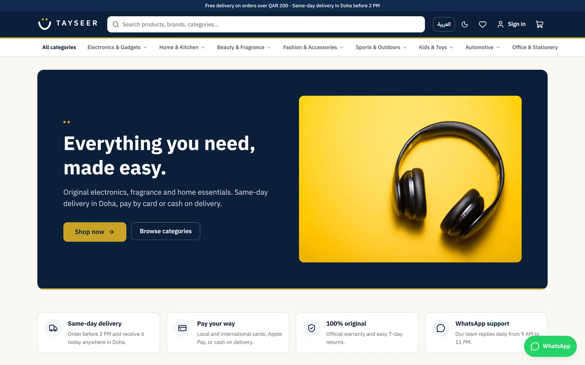

# Mourad Al Hassan — Portfolio

My personal portfolio: a pinned horizontal project gallery, a cursor-following character, and animated sections, built to stay smooth on slow computers.

**Live:** https://mourad-portfolio-mix.vercel.app



## Highlights
- **Horizontal project gallery** pinned with GSAP ScrollTrigger. Text and screens slide in once, so scrolling stays smooth.
- **Cursor-following character** made of 36 real head-turn poses. Exactly one pose is drawn at a time, picked by the cursor's angle, so there is no blending or double image. The poses preload from `<head>`, and phones get a still image.
- **Performance work:** self-hosted fonts, infinite animations pause when off-screen, no WebGL. Tested at 4x CPU throttling.
- Hover-to-open "How we start" steps, scroll-triggered reveals, and a cursor spotlight on cards.

## Stack
Next.js 16 · React 19 · TypeScript · Tailwind CSS 4 · GSAP

## Run it
```bash
npm install
npm run build && npm start   # http://localhost:3000
```
All content (projects, skills, text) lives in `src/lib/data.ts`.
